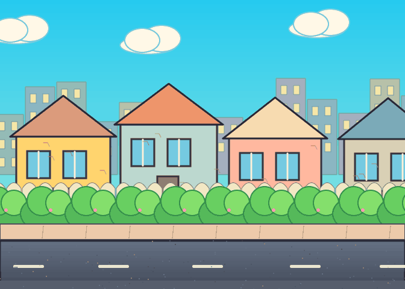

# Street Dash — Xiaomi Smart Band 10 Pro

An original hand-drawn, offline endless runner for **Xiaomi Smart Band 10 Pro Ceramic (Chinese Vela firmware)**.



## Download / Install

1. Go to **[Releases](https://github.com/danilfg/runner-smart-band-10-pro/releases)**.
2. Download **`Street-Dash-Band10Pro.rpk`** from the newest successful release.
3. In AstroBox choose your connected band → Quick Apps → Install RPK.
4. Go back to Mi Fitness after installation. *Avoid unnecessary unpairing or factory resets.*

> No one has yet confirmed this package running on a physical Smart Band 10 Pro Ceramic. Development builds use Xiaomi's debug signature. Test carefully. It is **not firmware**.

## Gameplay

- Choose one of two original cartoon heroes: **Kid** or **Gecko**.
- Tap the screen or swipe up to jump over cones and trash bins.
- Swipe down or press **SLIDE** to duck under high barriers.
- Collect stars, evade the villain's car, and survive as the city accelerates.
- Three hearts, pause/resume, restart, offline best-score saving.
- Text is in English, no Chinese-language UI.

## Build locally

Requires Node.js 20+ and access to npm:

```bash
npm install
npm run check
npm test
npm run build
```

Build output: `dist/*.debug.rpk` via the official [`aiot-toolkit`](https://iot.mi.com/vela/quickapp/en/tools/toolkit/start.html). The automatic GitHub Actions job renames the RPK to `Street-Dash-Band10Pro.rpk`, publishes a build artifact, and creates a release on every push to `main`.

## Continuous delivery

[GitHub Actions](https://github.com/danilfg/runner-smart-band-10-pro/actions/workflows/release.yml) runs validation, builds a real RPK using Xiaomi's `aiot build`, checks the file exists, and publishes it through GitHub Releases. The job can also be started manually with **Run workflow**. A failed build will not publish an RPK.

## Device & asset notes

- Designed for the Band 10 Pro's **336×480 portrait coordinate system**.
- Original PNG graphics generated by `python scripts/generate_assets.py` (requires `cairosvg` and `Pillow`). The reference cartoons supplied by the user are *visual references only*, not copied into the release.
- All game mechanics work offline. AstroBox is only needed to install the Quick App. Mi Fitness can remain the daily companion app when connectivity permits.
- High refresh rates on different firmware versions may affect performance; the update loop targets 20 FPS and has not yet been profiled on hardware.

## Licensing

Original source code and original vector art in this repository: MIT License. No third-party cartoon artwork is bundled.
